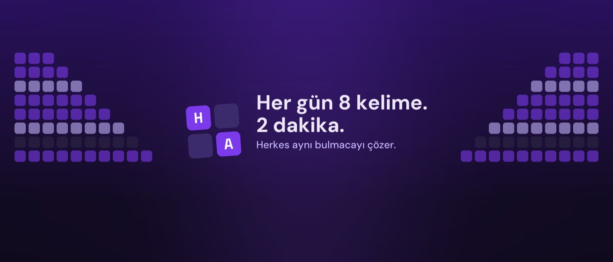
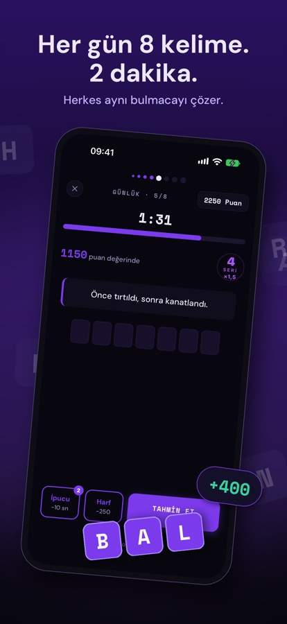
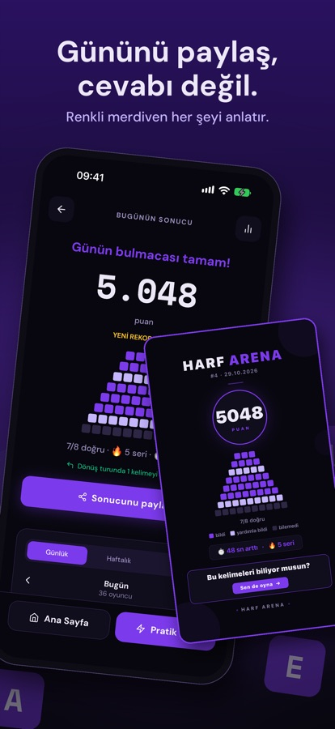
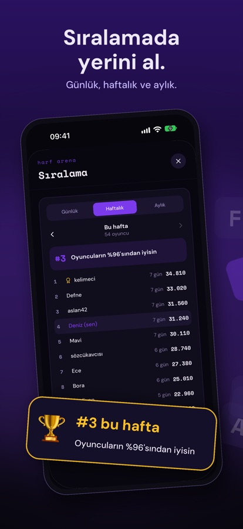
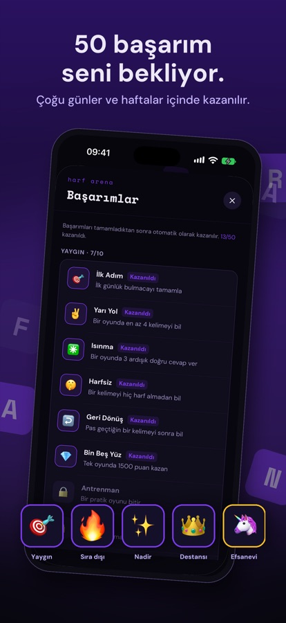

# Harf Arena

**Her gün 8 kelime. 2 dakika.** (Every day, 8 words. 2 minutes.)

A Turkish daily word game for iPhone and iPad. Everyone gets the same 8 words, from 3 to 10 letters, and solves them from their clues. It's free, with no ads, no purchases and no sign-up.

[App Store](https://apps.apple.com/tr/app/harf-arena/id6761937209?l=tr) · [Website](https://harf-arena-web.vercel.app)

> **Why is the code private?** It contains upcoming puzzles, and you'd be top of the leaderboard by lunch. This page is the product story instead.

<table>
  <tr>
    <td></td>
    <td></td>
    <td></td>
    <td></td>
  </tr>
</table>

App Store images. Names and scores are demo data.

## The idea

A good daily game gives you one thing to do today and a reason to come back tomorrow.

- **Same puzzle for everyone**, so there's something to compare and talk about.
- **Two minutes**, so it fits a coffee, a bus stop or a meeting you should be listening in.
- **A share card that shows your day, not the answers.** Our line for it is *"Gününü paylaş, cevabı değil"*: share your day, not the answer.

## Decisions I made, and why

### 1. I found the real bottleneck, and it wasn't the game

A daily game needs a lot of content, and my real limit was the time it took to write and review clues. Each one has to be good: fair, modern and leading to exactly one answer.

So I stopped treating words as an editing job and made them a **pipeline with quality gates**:

| Gate | What it checks |
|---|---|
| Second review | A separate pass tries to find problems in each clue |
| Blind solver test | Can someone solve the clue without seeing the answer, and does it lead to exactly one word? |
| Rival check | Does another word of the same length also fit? |
| Automatic fix | Failed clues get at most two attempts, then they're out |
| Player reports | Players can report a bad question, and reports go back through the pipeline |
| Budget limit | Each run stops before it goes over budget |

I moved from reviewing every word to reviewing the process. Now I argue with the system instead of with individual verbs.

### 2. I ran the supply numbers before they could surprise me

When I checked the approved words, the result was **72 easy, 12 medium and 1 hard**. That sounds like a lot until you try to build balanced days from it: it filled about **3 mixed days**.

The longest words were worse. There were only **239 candidates with 10 letters**, or about 5 months of daily games. So I changed where words come from and how they're picked:

- A wider source took 10-letter candidates from **239 to 927**, and 9-letter from **390 to 1,267**.
- Half of each batch now comes from deeper in the frequency list, so hard words exist at all.
- Each day has limits on hard words, verbs and grammar questions.

Daily puzzles are now scheduled months ahead, from a pool of more than 1,100 questions.

### 3. I cut features, including one I'd spent real effort on

- **Simulated rivals.** I built a bot opponent and calibrated it across 1,000 puzzles and 3,000 simulated runs. Then I cut it. Sunk cost is not a feature.
- **Challenge codes.** Removed in 1.2.0.
- **Ads.** Taken out of the native build.

### 4. I modelled the bill before it existed

I measured what each app open downloads and what that means at scale:

| Scenario at 10,000 daily players | Per sync | Data per month |
|---|---|---|
| Today: sync 5 days on every open | 5.5 KB | About 5 GB, the free plan's limit |
| Planned: fetch only today, once a day | 1.4 KB | About 0.4 GB |

We don't have 10,000 daily players. But this fix is cheap now and would be stressful later, so it's first on the 1.3.0 list.

### 5. I designed for habit without being annoying

- **Streaks with mercy:** one streak freeze 🧊 earned every 7 days, at most 2 held. Missing one day shouldn't end the relationship.
- **50 achievements** across five rarities, most of which take days or weeks.
- **A guided first game** with easy words and short coach marks, because rules are easier to learn by playing.
- **Daily, weekly and monthly leaderboards** with name filtering and reporting.

## How I measure it, and how I listen

- **Usage and crashes:** anonymous events and crash reports, on by default through a ticked box on first launch, and can be turned off any time.
- **Feedback has an owner for each type:**

| Feedback | What happens |
|---|---|
| Bad question report | Goes through the word pipeline |
| Bug | Gets a fix with a test, in the next release |
| Idea or wish | Goes to a backlog with a recommendation and how many players asked for it. I decide |
| Praise | Counted. I may also read it twice |

**Where are the numbers?** The app is brand new. My brief bans phrases like *"Binlerce oyuncu"* (thousands of players) until there's a real figure with a source, so for now you get the method.

## Getting it in front of people

The launch plan is **organic TikTok only**, with a 28-day schedule of 14 videos and 14 photo posts.

Each video is a puzzle you play along with, and it's built for retention:

| Part | What the viewer sees |
|---|---|
| Hook (first second) | The puzzle itself: a clue, empty boxes and a running timer. No logo, no intro |
| Lock-in | "3 words. The last one has 9 letters." |
| Easy word | A quick win keeps you watching |
| Rehook | "The second one is harder." |
| Hard word | The answer comes last |
| End card | "How many did you get? Write it in the comments." |

Every word in the videos is reserved, so a post can never give away a real daily answer.

## Release discipline

- The production branch always matches what's in the App Store.
- A release has a checklist: test build, real-device test, privacy check, store text and word stock.
- Every claim in the store, on the site or in a post has to match what the code does.

The one exception to all this order is the app's internal slug, which still says `harf-arene`, an earlier spelling of the name. Renaming it isn't worth the risk. Every product has a family secret.

## What I took from it

1. For a content product, the content system *is* the product.
2. Count your inventory by the hardest constraint, not by the total.
3. Features you cut don't need a funeral. A short commit message will do.

---

*Back to [my profile](https://github.com/yuceugur).*
